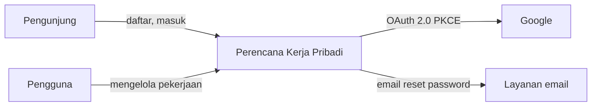
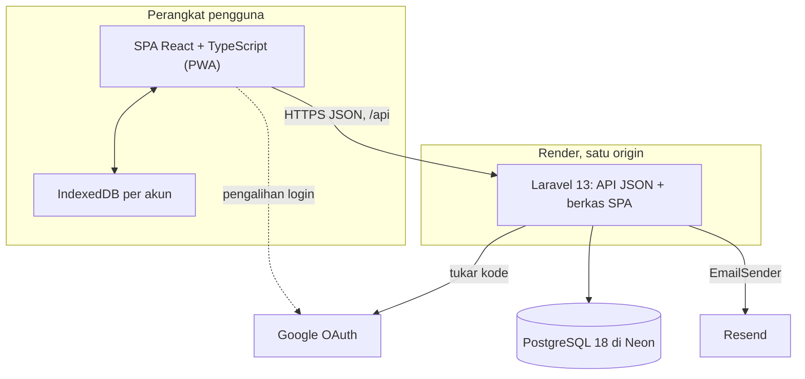
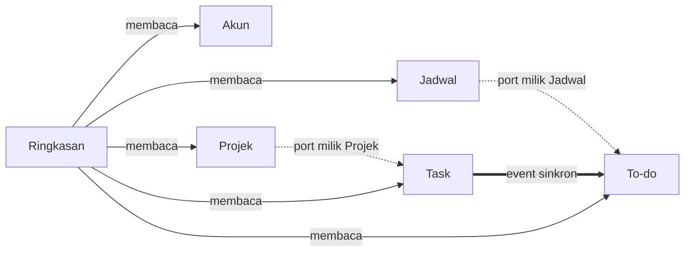
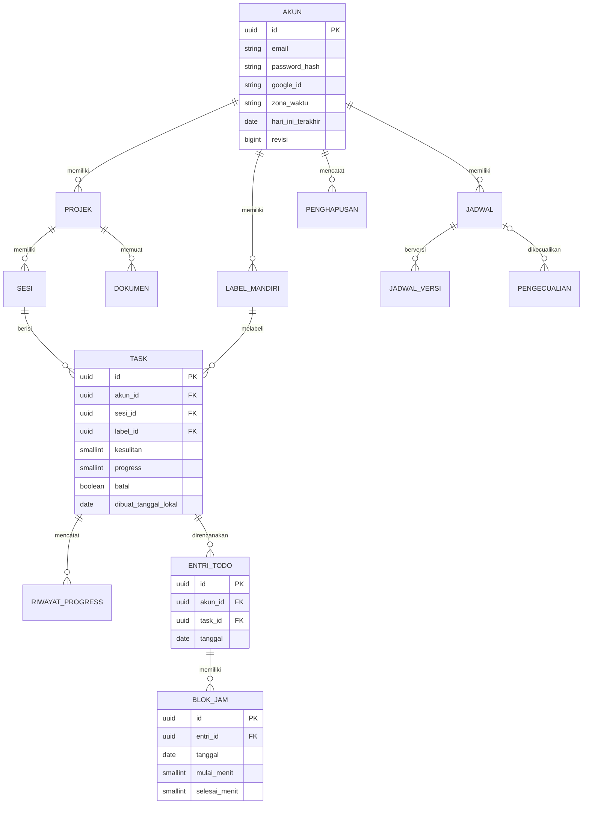
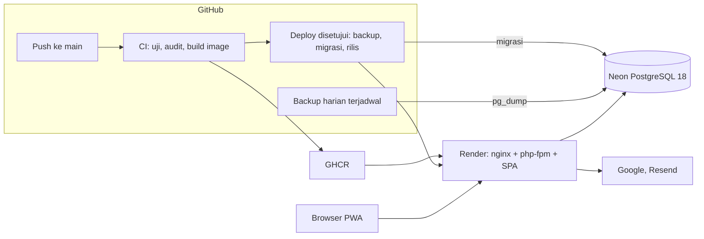
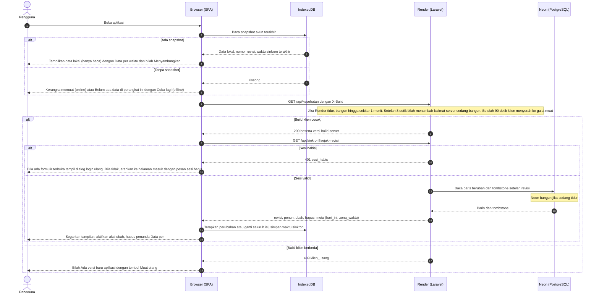
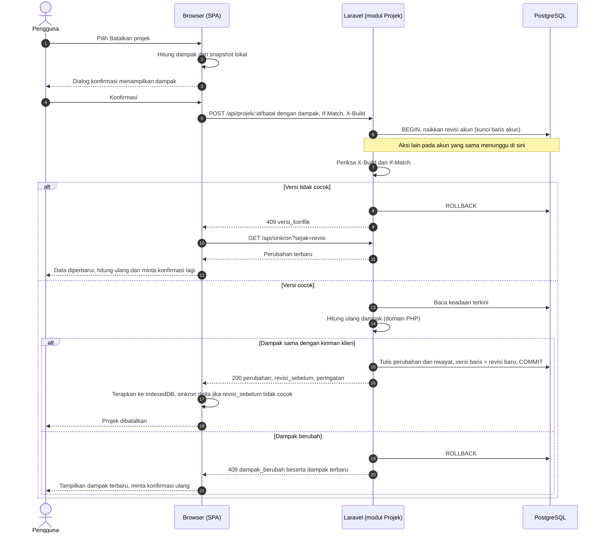

# Dokumen Arsitektur Sistem: Perencana Kerja Pribadi

Nov 15, 2026 · @cah

> Dokumen ini merangkum keputusan arsitektur yang dibahas dan disetujui berurutan dalam delapan tahap. Dokumen pendamping: Spesifikasi Kebutuhan (FR dan NFR), Dokumen Use Case, dan Dokumen Arsitektur Informasi. Perubahan terhadap spesifikasi tercatat di Bagian 11 dan sudah diterapkan ke Spesifikasi Kebutuhan pada 15 Nov 2026. Pada hari yang sama dokumen ini diselaraskan dengan keputusan wireframe (Bagian 5.4, 6, 7, 8.4, dan 10).

## 0. Cara membaca dokumen ini

**Status.** Semua keputusan di sini sudah disetujui per tahap. Yang belum diputuskan atau belum diverifikasi ada di Bagian 12.

**Penomoran rujukan.**

| Awalan | Arti | Bagian |
| --- | --- | --- |
| FR, NFR (A-01, N-10, dst.) | Butir di Spesifikasi Kebutuhan | Seluruh dokumen |
| AD-1 sampai AD-8 | Keputusan arsitektur | 4 |
| DA-1 dan seterusnya | Keputusan arsitektur data | 6 |
| IF-1 sampai IF-5 | Antarmuka antarkomponen | 7 |
| S-1 sampai S-7 | Keputusan keamanan | 8 |
| DP-1 sampai DP-10 | Keputusan deployment | 9 |

**Delapan tahap pembahasan:** (1) System Context, (2) spesifikasi arsitektur, (3) Architectural Design, (4) Component Design, (5) Data Architecture, (6) Interface Architecture, (7) Security Architecture, (8) Deployment Architecture.

## 1. Ringkasan

Perencana Kerja Pribadi adalah aplikasi web perencana kerja per akun dengan struktur Projek → Sesi → Task, to-do harian berblok jam, Jadwal tetap, Kalender, dan Dashboard. Arsitekturnya dirancang untuk satu tim kecil dan fase lomba, dengan jalur naik ke hosting berbayar tanpa mengubah desain.

| Aspek | Keputusan inti |
| --- | --- |
| Gaya | Modular monolith. Server adalah sumber kebenaran tunggal, perangkat memegang snapshot baca-saja untuk offline (AD-1, AD-2) |
| Frontend | React + TypeScript + Vite + Tailwind, SPA yang bisa dipasang (PWA) |
| Backend | Laravel 13, API JSON saja (tanpa Blade atau Inertia), menyajikan SPA dari origin yang sama |
| Database | PostgreSQL 18 satu instans, setiap tabel data punya `akun_id` |
| Konsistensi | Satu aksi = satu transaksi dengan kunci per akun. Aksi berdampak memakai pola "dampak yang diharapkan" (AD-3, AD-4) |
| Sinkronisasi | Pembacaan lewat `GET /api/sinkron?sejak=<revisi>` (penuh atau delta). Tampilan lain dihitung di perangkat |
| Autentikasi | Sanctum SPA (cookie sesi + CSRF), Argon2id, Google OAuth 2.0 dengan PKCE |
| Hosting | Render (Docker, paket gratis) + Neon (PostgreSQL gratis) + Resend (email) + GitHub Actions (CI/CD dan backup) |

## 2. System Context

### 2.1 Aktor dan sistem eksternal

| Pihak | Peran | Interaksi |
| --- | --- | --- |
| Pengunjung | Belum masuk | Mendaftar, masuk, meminta reset password |
| Pengguna | Sudah masuk | Mengelola projek, sesi, task, to-do, Jadwal, Kalender, Dashboard, dan Akun. Hanya bisa mengakses data miliknya sendiri (U-01) |
| Google | Penyedia identitas | OAuth 2.0 authorization code dengan PKCE. Cakupan izin: `openid`, `email`, `profile` |
| Layanan email | Pengirim email | Hanya email reset password (N-71) |

**Admin bukan aktor.** Tidak ada halaman atau peran admin di dalam aplikasi (N-23). Pemulihan akun (N-63) dan backup (N-74) adalah prosedur operasional yang dijelaskan di Bagian 9.

### 2.2 Diagram konteks



## 3. Spesifikasi arsitektur

| Lapisan | Pilihan | Catatan |
| --- | --- | --- |
| Frontend | React, TypeScript (mode ketat), Vite, Tailwind | SPA dan PWA. Snapshot offline di IndexedDB per akun |
| Backend | PHP 8.4 atau 8.5, Laravel 13 | API JSON. Eloquent untuk akses data biasa, SQL mentah untuk agregat (Pola kerja) |
| Database | PostgreSQL 18, ekstensi `btree_gist` | `uuidv7()` bawaan. Exclusion constraint untuk rentang tanpa tumpang tindih |
| Autentikasi | Laravel Sanctum mode SPA | Cookie sesi + CSRF. Sesi di tabel `sessions` |
| Login Google | Laravel Socialite | PKCE, state, hanya email terverifikasi |
| Email | Laravel Mail dengan Resend | Sinkron, tanpa antrean |
| Kontrak API | Scramble (OpenAPI 3.1) → `openapi-typescript` → `openapi-fetch` | Versi `openapi-fetch` di-pin (masih 0.x). CI membuat ulang tipe dan gagal bila ada drift |
| Pengujian | Pest atau PHPUnit (PostgreSQL asli), PHPStan atau Larastan, Vitest, Playwright | Uji browser untuk 2 sampai 3 alur kritis |
| Repositori | Monorepo pnpm: `apps/web`, `apps/api`, folder fixture bersama | Tidak ada paket kode bersama |
| CI/CD | GitHub Actions | Aksi dikunci ke SHA, izin `contents: read` |

**Mengapa Laravel menyajikan SPA.** Satu origin menghilangkan CORS, menyederhanakan cookie `__Host-` dan CSRF, dan mempermudah pengalihan balik Google. Frontend tetap proyek terpisah di `apps/web` yang di-build lalu disalin ke `public/` dalam image.

**Versi runtime.** PHP dan versi Node LTS untuk build di-pin satu versi saat implementasi. Node hanya dipakai untuk build dan uji, bukan runtime produksi.

## 4. Architectural Design

### 4.1 Struktur keseluruhan



### 4.2 Keputusan arsitektur

| ID | Keputusan | Alasan |
| --- | --- | --- |
| AD-1 | **Modular monolith.** Satu aplikasi Laravel dengan enam modul berbatas jelas (Bagian 5) | Tim kecil, satu database, transaksi lintas modul mudah |
| AD-2 | **Server sumber kebenaran tunggal.** Perangkat memegang snapshot baca-saja. Saat offline, semua tombol ubah dinonaktifkan (N-47) | Menghindari penyelesaian konflik data dua arah |
| AD-3 | **Satu aksi = satu transaksi dengan kunci per akun.** Kunci diambil dengan menaikkan nomor revisi pada baris akun sebagai pernyataan pertama transaksi pengubah | Aturan lintas tabel (N-75) aman tanpa constraint. Satu mekanisme untuk kunci, versi, dan kursor sinkron. Menggantikan advisory lock yang semula dirancang |
| AD-4 | **Pola "dampak yang diharapkan".** Klien menghitung dampak dan mengirimkannya. Server menghitung ulang di bawah kunci. Bila berbeda, aksi ditolak dengan dampak terbaru (409 `dampak_berubah`) | Memenuhi I-10 tanpa membuka celah data yang berubah di perangkat lain |
| AD-5 | **Status turunan tidak disimpan** (N-04). Yang disimpan: batal, progress task, dan metadata waktu | Menghindari data yang saling bertentangan |
| AD-6 | **"Hari ini" ditentukan server** menurut zona waktu akun dan tidak pernah mundur (U-14, N-44). Klien menerimanya lewat `meta.hari_ini` | Konsisten di semua perangkat |
| AD-7 | **Satu origin.** Laravel menyajikan SPA dan API | Lihat Bagian 3 |
| AD-8 | **Domain murni dipisah di kedua sisi.** Aturan domain berupa fungsi murni (PHP dan TypeScript) dengan `today` dan `nowMinutes` sebagai parameter | Dapat diuji tanpa database atau antarmuka |

## 5. Component Design

### 5.1 Modul backend

| Modul | Tanggung jawab |
| --- | --- |
| Akun | Registrasi, login email, login Google dan penautan, sesi, reset password, ganti password, pembatasan percobaan, zona waktu, penanda "hari ini terakhir" |
| Projek | Projek, Sesi, dan Dokumen. Status projek dan sesi, aturan penutupan projek (2.4), perhitungan dan penerapan dampak aksi berantai (selesai dini, batal, ubah periode, hapus sesi) |
| Task | Task, label mandiri, progress, dan riwayat progress. Pindah, batal, buka kembali. Mengirim event ke modul To-do |
| To-do | Entri to-do dan blok jam. Ceklis, pembekuan hari lewat, pemeriksaan blok terhadap Jadwal |
| Jadwal | Jadwal, versi Jadwal, pengecualian. Jadwal efektif per hari, pola mingguan, penandaan blok yang bentrok |
| Ringkasan | Merakit respons sinkron (penuh dan delta) untuk snapshot offline, serta agregat Pola kerja (D-11, D-12) |

Jam kosong (F-07, D-09) tidak dihitung server. Perhitungannya ada di perangkat.

### 5.2 Ketergantungan antarmodul



Siklus ketergantungan diselesaikan dengan dua mekanisme:
- **Antarmuka milik pemanggil (port).** Projek memanggil Task lewat antarmuka yang didefinisikan di modul Projek. Jadwal memanggil To-do lewat antarmuka yang didefinisikan di modul Jadwal.
- **Event sinkron dari Task ke To-do.** Event: progress berubah, selesai, buka kembali, batal. Event berjalan dalam transaksi yang sama.

### 5.3 Pembagian aturan domain

Aturan domain berupa fungsi murni dengan tanggal berformat ISO dan jam berupa menit bilangan bulat. Dua implementasi (PHP dan TypeScript) diikat oleh golden fixtures bersama di folder fixture monorepo. Cakupan dibatasi pada aturan yang benar-benar dipakai server.

| Ditulis di PHP dan TypeScript (diikat fixture) | Ditulis di TypeScript saja |
| --- | --- |
| Status projek dan sesi | Jam kosong |
| Telat dan di luar periode | Urutan task aktif (D-04) |
| Aturan penutupan projek (2.4) dan dampak | Status entri to-do |
| Jadwal efektif dan pola mingguan | "N dari M task selesai" |
| Penandaan bentrok blok dan Jadwal | "Setelah deadline" |
| Pembantu tanggal dan "hari lewat" | "Belum selesai" (E-09) |

Agregat Pola kerja adalah kueri SQL. Ia diuji dengan fixture yang sama yang dimuat ke PostgreSQL.

### 5.4 Struktur frontend

- **Domain murni** (TypeScript) tanpa ketergantungan pada React atau jaringan.
- **Lapisan data lokal:** penyimpanan IndexedDB per akun (`perencana:{akun_id}`), satu store per tabel, ditambah metadata dan hasil Pola kerja terakhir. Metadata memuat nomor revisi terakhir dan waktu sinkron terakhir yang berhasil (`disinkron_pada`). Waktu itu dipakai untuk penanda "Data per [waktu]" (N-47), bersama zona waktu akun dari snapshot (N-45). Penanda tetap tampil sampai sinkron setelah kembali online selesai. Ada juga store `draf_formulir` (DA-10). Semua dihapus saat keluar atau saat akun lain masuk (N-60).
- **Klien API** dari `openapi-fetch` dengan tipe hasil generate.
- **Pembaruan instan (N-50).** Ceklis, update progress, tambah ke to-do, dan hapus entri diterapkan ke penyimpanan lokal lebih dulu, lalu dikirim ke server. Bila server menolak atau tidak menjawab, baris dikembalikan ke keadaan semula dengan pesan di bawahnya dan tautan Coba lagi, tanpa toast. Aksi bertingkat konfirmasi tidak instan: ia menunggu server (AD-4).
- **Status sistem (N-11).** Satu komponen bilah tipis, tidak bisa ditutup, untuk Menyambungkan, Offline, Tersambung kembali, versi baru aplikasi, dan galat.
- **UI** React dengan komponen bersama (N-21).
- Semua tampilan turunan (Kalender, Dashboard, daftar to-do, filter, jam kosong) dihitung dari snapshot lokal.

## 6. Data Architecture

### 6.1 Keputusan data

| ID | Keputusan |
| --- | --- |
| DA-1 | Satu database PostgreSQL 18. Kunci utama UUIDv7 yang diberikan server (`uuidv7()`), kecuali entri to-do yang boleh membawa `id` buatan klien |
| DA-2 | Setiap tabel data punya `akun_id`. Foreign key anak bersifat komposit `(akun_id, id)`. Tanpa `ON DELETE CASCADE` (semua RESTRICT) |
| DA-3 | Tanggal bertipe `date`. Jam disimpan sebagai menit `smallint` 0 sampai 1440. `timestamptz` UTC hanya untuk metadata |
| DA-4 | Kejadian yang dikelompokkan per hari (riwayat progress, selesai, batal) menyimpan tanggal dan menit lokal saat kejadian. Task juga menyimpan `dibuat_tanggal_lokal` |
| DA-5 | Hanya "batal" yang disimpan: boolean pada projek dan sesi, serta boolean + `dibatalkan_pada` + tanggal dan menit lokal pada task. Task menyimpan `progress` |
| DA-6 | Riwayat progress append-only: pemicu (trigger) menolak ubah dan hapus, dan hak UPDATE/DELETE dicabut dari role aplikasi |
| DA-7 | "Selesai" = progress 10. Waktu selesai diambil dari baris riwayat terakhir yang bertanda selesai |
| DA-8 | **Status entri to-do:** "dikerjakan" bila entri dicentang atau ada riwayat progress untuk task itu pada tanggal entri. Prioritas tetap mengikuti E-07 |
| DA-9 | Pilihan tampilan Kalender terakhir (J-03) disimpan di perangkat (`localStorage`) |
| DA-10 | **Draf formulir untuk login ulang lewat Google** (U-13) disimpan di IndexedDB per akun, store `draf_formulir`, sebelum pengalihan ke Google. Draf dikembalikan setelah pengalihan balik, lalu dihapus. Draf juga dihapus saat keluar atau saat akun lain masuk (N-60). Draf hanya ada di perangkat dan tidak dikirim ke server |

### 6.2 Entitas

| Tabel | Isi dan catatan penting |
| --- | --- |
| `akun` | Email (dipangkas dan huruf kecil, unik), nama tampil, `password_hash` (boleh kosong), `google_id`, `zona_waktu`, `hari_ini_terakhir`, nomor revisi akun |
| `projek` | Nama, deskripsi, warna, penanda batal |
| `dokumen` | Dokumen projek (maks 10, diperiksa aplikasi) |
| `sesi` | Rentang tanggal inklusif, penanda batal |
| `label_mandiri` | Label task mandiri, dengan `terakhir_dipakai` untuk urutan saran |
| `task` | Tepat satu dari `sesi_id` atau `label_id` (XOR). Deadline wajib untuk task sesi. `kesulitan` (wajib, 1 sampai 5), `progress`, batal, tanggal lokal |
| `riwayat_progress` | Nilai sebelum dan sesudah, deskripsi, penanda Selesai atau Buka kembali, tanggal dan menit lokal |
| `entri_todo` | Satu entri per task per hari, status ceklis |
| `blok_jam` | Salinan `tanggal` dari entri. Foreign key komposit `(entri_id, tanggal)` |
| `jadwal` | Identitas Jadwal |
| `jadwal_versi` | Versi mingguan (hari ISO 1 sampai 7) atau sekali jalan (versi satu hari). Rentang berlaku per versi |
| `pengecualian` | Rentang tanggal. `jadwal_id` kosong berarti "semua" Jadwal |
| `penghapusan` | Tombstone untuk sinkron delta: tabel, id, revisi |

Tabel Laravel: `sessions`, `cache` (penghitung percobaan), dan `password_reset_tokens`.

### 6.3 Aturan yang dijaga database

- Email unik (tanpa beda kapital). Nama projek dan label unik per akun (indeks ekspresi).
- Nama sesi non-batal unik per projek (indeks unik parsial).
- Rentang sesi non-batal tidak tumpang tindih (exclusion constraint dengan `btree_gist`).
- Satu entri to-do per task per hari.
- Blok tidak tumpang tindih per akun dan tanggal (semua blok dihitung). Exclusion constraint.
- Versi Jadwal tidak tumpang tindih per Jadwal. Exclusion constraint.
- CHECK untuk rentang jam, XOR sesi atau label, batas nilai progress, dan kesulitan 1 sampai 5 (NOT NULL).
- Label yang masih dipakai task (aktif, selesai, atau batal) tidak bisa dihapus karena foreign key `task.label_id` bersifat RESTRICT (DA-2).

### 6.4 Aturan yang dijaga aplikasi (di bawah kunci akun, N-75)

- Warna unik di antara projek belum tertutup.
- Nama projek tidak boleh sama dengan label mandiri.
- Nama task aktif unik per label.
- Maksimal 10 dokumen per projek.
- Deadline di dalam periode sesi.
- Blok terhadap Jadwal (diizinkan dengan peringatan, F-08).
- Hari lewat membeku.
- Hapus label: aplikasi memeriksa lebih dulu bahwa label tidak punya task, agar penolakan berupa pesan yang jelas dan bukan galat foreign key. Label task mandiri tidak bisa diganti kecuali task dipindahkan ke sesi (C-04).

### 6.5 Penyimpanan lain

- Sesi: tabel `sessions` (driver database).
- Penghitung percobaan: tabel `cache` (driver database), TTL 24 jam, kunci berupa HMAC dari email.
- Snapshot offline dan draf formulir: IndexedDB per akun.
- Tanpa Redis, antrean, atau penyimpanan berkas di server.

### 6.6 Perkiraan volume

Pada volume N-08, perkiraan kasar: sekitar 25 MB database per akun dan sekitar 20 MB JSON untuk snapshot, dengan riwayat progress lebih dari separuhnya. Dengan batas 1 GB, Neon gratis menampung sekitar 40 akun bervolume penuh. Karena itu pemakaian storage dipantau (Bagian 9).

### 6.7 ERD

Daftar kolom lengkap ada di migrasi. ERD ini menunjukkan entitas, relasi, dan kolom kunci.



## 7. Interface Architecture

### 7.1 Antarmuka

| ID | Antarmuka | Protokol |
| --- | --- | --- |
| IF-1 | Browser ↔ Laravel | HTTPS JSON, satu origin |
| IF-2 | Browser → Google | Pengalihan (redirect) halaman login Google. Draf formulir yang sedang terbuka disimpan lokal lebih dulu (DA-10) |
| IF-3 | Laravel → Google | Penukaran kode, dengan PKCE dan state |
| IF-4 | Laravel → PostgreSQL | Koneksi TLS (verify-full). Runtime lewat endpoint pooled |
| IF-5 | Laravel → Resend | Lewat antarmuka `EmailSender` |

### 7.2 Konvensi API

- REST di bawah `/api`, tanpa versi di URL. Istilah domain berbahasa Indonesia di URL dan JSON, dengan nama `snake_case`.
- Aksi berbentuk `POST /api/<sumber>/{id}/<aksi>` (contoh: `POST /api/projek/{id}/batal`). Aksi yang menetapkan keadaan memakai `PUT` (contoh: `PUT …/ceklis`).
- Header `X-Build` pada setiap permintaan. Bila berbeda dari build server, jawabannya 409 `klien_usang` dan klien menampilkan bilah "Ada versi baru aplikasi" dengan tombol Muat ulang (N-76).
- Header `If-Match: <versi>` untuk kendali konkurensi.
- Server menulis pesan galat dalam bahasa Indonesia (`pesan`).

### 7.3 Pembacaan dan sinkronisasi

Pembacaan hanya lewat dua endpoint:
- `GET /api/sinkron?sejak=<revisi>` menghasilkan seluruh data (penuh) atau perubahan (delta).
- `GET /api/pola-kerja?dari=&sampai=` menghasilkan agregat Pola kerja.

Semua tampilan lain dihitung di perangkat.

**Nomor revisi akun.** `versi` adalah nomor revisi akun (`bigint`). Setiap transaksi pengubah menaikkannya sebagai pernyataan pertama, yang sekaligus mengunci baris akun (AD-3). Baris yang berubah diberi `versi` = revisi baru. Penghapusan dicatat di tabel `penghapusan`.

**Bentuk respons delta:**

```json
{
  "revisi": 1234,
  "penuh": false,
  "ubah": { "...": "baris yang berubah per tabel" },
  "hapus": [ { "tabel": "...", "id": "..." } ],
  "meta": { "hari_ini": "2026-11-15", "zona_waktu": "Asia/Jakarta" }
}
```

Respons mutasi memakai bentuk "perubahan" yang sama, ditambah `revisi_sebelum` dan `peringatan`. Riwayat progress ikut disinkronkan. Bila klien membawa `sejak` yang lebih tua dari tombstone yang masih tersimpan, server membalas `penuh: true`.

### 7.4 Kontrak dampak (I-10)

Untuk aksi yang memerlukan konfirmasi, klien selalu mengirim `dampak`:

```json
{
  "projek_menjadi": "selesai",
  "task_batal": ["id", "..."],
  "task_di_luar_periode": ["id", "..."],
  "sesi_dihapus": ["id", "..."],
  "sesi_batal": ["id", "..."],
  "sesi_dipotong": [ { "id": "...", "akhir_baru": "2026-11-14" } ]
}
```

Daftar id diurutkan agar perbandingan stabil. Server menghitung ulang di bawah kunci dan membandingkan.

### 7.5 Galat

| Kode HTTP | `kode` | Arti |
| --- | --- | --- |
| 401 | `sesi_habis` | Sesi tidak valid atau kedaluwarsa. Klien membedakan dua keadaan (U-13): bila formulir sedang terbuka, tampil dialog login ulang (email terkunci, tanpa Batal, isian tidak hilang). Bila tidak, klien menuju halaman masuk dengan pesan sesi habis, lalu kembali ke tujuan semula |
| 404 | n/a | Tidak ditemukan (termasuk data akun lain) |
| 409 | `versi_konflik` | `If-Match` tidak cocok. Pada formulir (N-46), klien boleh menyinkron di latar, tetapi isian pengguna tidak ditimpa dan Simpan tetap nonaktif sampai pengguna menekan Muat ulang |
| 409 | `dampak_berubah` | Dampak berbeda dari kiriman klien (menyertakan dampak terbaru) |
| 409 | `klien_usang` | `X-Build` berbeda dari server. Klien menampilkan bilah "Ada versi baru aplikasi" (N-76) |
| 422 | `validasi_gagal` | Validasi gagal (dengan `kolom` dan `rincian`) |
| 429 | `terlalu_banyak_percobaan` | Pembatasan percobaan (dengan `tunggu_detik`) |
| 5xx | `kesalahan_server` | Galat server |

### 7.6 Idempotensi dan percobaan ulang

- Endpoint penetapan keadaan (`PUT …/ceklis`) idempoten. Entri to-do memakai `id` buatan klien.
- Tidak ada kunci idempotensi umum.
- Saat aplikasi dibuka, klien memanggil `GET /api/kesehatan` lebih dulu untuk membangunkan server (tampilan "Menyambungkan…").
- Permintaan pengubah tidak diulang otomatis, kecuali `PUT` dan entri dengan `id`. Tautan "Coba lagi" pada aksi instan yang gagal (N-50) adalah percobaan ulang atas perintah pengguna. Bila permintaan pertama sebenarnya sudah tersimpan di server, percobaan ulang ditolak oleh pemeriksaan versi atau oleh aturan nilai harus berbeda (C-06), sehingga tidak menggandakan data.

### 7.7 Alur tipe

Scramble menghasilkan OpenAPI 3.1 dari kode Laravel. `openapi-typescript` membuat tipe, dan `openapi-fetch` dipakai klien. CI membuat ulang tipe dan gagal bila ada perbedaan. Generator TypeScript bawaan Scramble hanya tersedia di versi PRO, sehingga tidak dipakai.

### 7.8 Login Google

Rute `/auth/google/redirect` dan `/auth/google/callback` berada di luar `/api` karena berupa pengalihan halaman penuh. Alur memakai PKCE dan state, dengan sesi bersifat stateful.

Pengalihan halaman penuh menghapus isian formulir dari memori. Untuk login ulang saat sesi habis (U-13), SPA menyimpan isian formulir ke store `draf_formulir` (DA-10) sebelum mengalihkan ke `/auth/google/redirect`, lalu memulihkannya setelah pengalihan balik dan menghapusnya.

### 7.9 Katalog endpoint

Katalog endpoint per modul dihasilkan dari OpenAPI (Scramble) dan belum dituliskan ulang di dokumen ini. Lihat Bagian 12.

## 8. Security Architecture

### 8.1 Lapisan perlindungan

Peramban dianggap tidak tepercaya. Setiap permintaan melewati lapisan di Laravel (header dan CSP, autentikasi sesi dan CSRF, pembatasan laju, validasi input dan otorisasi per akun, lalu akses data berfilter akun) sebelum menyentuh PostgreSQL. Isolasi akun dijaga ulang di tingkat database.

### 8.2 Keputusan keamanan

| ID | Keputusan |
| --- | --- |
| S-1 | **Kata sandi:** Argon2id dengan parameter minimum OWASP (19 MiB, t=2, p=1), di-benchmark di host. Verifikasi hash tiruan untuk email tak dikenal (menyamakan waktu). Hash dibuat ulang bila parameter berubah |
| S-2 | **Sesi:** cookie sesi Sanctum bernama `__Host-…` (httpOnly, Secure, SameSite=Lax). ID sesi dibuat ulang saat login. Sesi di tabel `sessions`. Pencabutan dengan menghapus baris (kecuali sesi saat ini). Darurat: `TRUNCATE sessions` |
| S-3 | **Isolasi akun, tiga lapis:** (a) foreign key komposit di database; (b) trait scope pada model dan route-model binding berscope, dengan `akun_id` tidak pernah berasal dari input; (c) pengujian: uji arsitektur Pest bahwa setiap model memakai trait, dan matriks rute × dua akun yang mengharapkan 404. RLS ditunda. Role database dipisah: `app_runtime` (CRUD, tanpa DDL) dan `app_migrasi`. UPDATE dan DELETE dicabut pada riwayat |
| S-4 | **Header dan CSP:** `default-src 'self'`, `script-src 'self'`, `connect-src 'self'`, `img-src 'self' data:`, `worker-src 'self'`, `frame-ancestors 'none'`, `base-uri 'none'`, dan pengecualian `style-src-attr` untuk gaya inline React. HSTS, `nosniff`, `Referrer-Policy: no-referrer`, Permissions-Policy, dan `Cache-Control: no-store` pada `/api`. CORS tidak diaktifkan. URL token reset dibersihkan dengan `history.replaceState`. URL dokumen hanya http atau https dengan `rel="noopener noreferrer"`. Deskripsi dirender sebagai teks biasa |
| S-5 | **Pembatasan tambahan:** batas registrasi baru per IP (contoh 10 per jam, N-77). Email reset dikirim `afterResponse` agar waktu respons sama. Sumber IP di balik proxy host diverifikasi saat deploy pertama (DP-9) |
| S-6 | **Pencatatan log:** JSON ke stderr dengan redaksi (tanpa email, nama, teks task, token, cookie, isi permintaan). Hanya `akun_id` yang boleh muncul. `APP_DEBUG=false` |
| S-7 | **Rantai pasok:** lockfile dikomit. `composer audit` dan `pnpm audit` menggagalkan CI. Daftar izin `onlyBuiltDependencies` di pnpm. Dependabot. Aksi GitHub dikunci ke SHA dengan `contents: read`. `gitleaks` di CI. Backup dienkripsi (age) dengan kunci terpisah |

### 8.3 Pemulihan akun oleh admin (N-63)

Skrip lokal yang memakai role `app_migrasi` menerbitkan tautan reset dan mencabut sesi. Prosedurnya didokumentasikan di README. Penghapusan akun manual dilakukan dengan skrip admin yang sama.

### 8.4 Risiko sisa yang diterima untuk fase lomba

- *Pre-hijacking:* data yang ditanam sebelum pemilik email sebenarnya mendaftar, karena email tidak diverifikasi.
- Enumerasi email lewat pesan "sudah terdaftar" (ditetapkan spesifikasi, U-02).
- Snapshot offline tidak dienkripsi. Draf formulir di IndexedDB (DA-10) sama: tidak dienkripsi, tetapi hanya ada sampai dipulihkan, dan dihapus saat keluar.
- Tidak ada batas umur mutlak sesi.
- Penghapusan akun dilakukan manual lewat skrip admin.

Sebelum rilis publik, pemberitahuan privasi dan mekanisme penghapusan akun perlu ditinjau terhadap UU Pelindungan Data Pribadi (UU 27/2022). Ini bukan nasihat hukum.

## 9. Deployment Architecture

### 9.1 Fakta hosting (diperiksa 15 Nov 2026)

| Layanan | Fakta yang memengaruhi desain |
| --- | --- |
| Render (web service gratis) | Tidur setelah 15 menit tanpa trafik masuk, bangun hingga sekitar satu menit. Filesystem sementara. 750 jam instance per bulan. Postgres gratis Render kedaluwarsa 30 hari. Satu sumber menyebut 512 MB RAM dan 0,1 vCPU |
| Neon (gratis) | 1 GB per project (dua sumber lain menyebut 0,5 GB, jadi angka di console yang berlaku). 100 CU-jam per bulan. Restore hanya 6 jam. Compute tidur setelah 5 menit dan tidak bisa dimatikan. Batas terlewati tidak menghapus data |
| Resend (gratis) | 100 email per hari dan 3.000 per bulan. Pengiriman berhenti saat batas tercapai |
| GitHub Actions | Jadwal bisa tertunda, terlewat, dan dimatikan otomatis setelah 60 hari tanpa aktivitas repo |

### 9.2 Keputusan deployment

| ID | Keputusan |
| --- | --- |
| DP-1 | **Hosting:** Render free (Docker) + Neon free (PostgreSQL 18) + Resend free + GitHub Actions. Jalur naik: Render berbayar (mulai $7 per bulan, tanpa tidur) dan Neon Launch (bayar sesuai pemakaian, tanpa migrasi data). **Ambang naik:** storage Neon di atas 70%, CU-jam di atas 80 dari 100, email di atas 70 per hari, atau cold start mengganggu demo. Fase gratis hanya menjamin fase lomba, bukan N-69 |
| DP-2 | **Runtime:** satu image Docker multi-stage (build SPA, `composer install --no-dev`, runtime nginx + php-fpm). SPA disajikan dari `public/`, gzip aktif, SHA git tertanam untuk `X-Build`. CI memeriksa `PASSWORD_ARGON2ID` dan membenchmark parameter Argon2 di instance Render. Image dibangun sekali di CI, didorong ke GHCR, dan ditarik Render. Auto-deploy Render dimatikan. Cadangan: Render build dari Dockerfile (memakai kuota menit build) |
| DP-3 | **Lingkungan:** lokal (docker compose, PostgreSQL 18), CI (service container PostgreSQL 18), produksi. Tanpa staging permanen (jam Render dan 1 GB Neon dipakai bersama). "Gladi rilis": Neon branch dari produksi untuk menguji migrasi yang mengubah skema |
| DP-4 | **Migrasi dan role:** runtime memakai `app_runtime` lewat endpoint pooled. Migrasi dan backup memakai role terpisah lewat koneksi langsung. Migrasi dijalankan job Deploy di GitHub, bukan dari container. Migrasi wajib kompatibel mundur (tambah dulu, hapus belakangan) karena versi lama masih melayani selama migrasi |
| DP-5 | **Pipeline:** CI (PHPStan, tsc, Pest, Vitest, drift OpenAPI, `composer audit`, `pnpm audit`, gitleaks, build image, Playwright terhadap image) pada PR dan main. Job Deploy hanya dari main, di environment `production` dengan persetujuan manual: backup pra-migrasi (N-38), migrasi, rilis image, smoke test (`/api/kesehatan/siap` dan `X-Build` sama dengan SHA) |
| DP-6 | **Backup (N-74):** harian pukul 03:17 WIB. `pg_dump` (klien versi 18), enkripsi age, artifact di repo privat, retensi 7 hari, role baca-saja `app_backup`. Restore 6 jam Neon untuk salah-migrasi. Latihan restore sebelum rilis publik dan tiap kuartal. Target pulih 4 jam. Pengawas: workflow cek kesegaran backup, `workflow_dispatch`, dan pengingat bulanan (jadwal bisa mati setelah 60 hari tanpa aktivitas) |
| DP-7 | **Perawatan mingguan** (workflow terjadwal, role migrasi): hapus baris cache kedaluwarsa, sesi lama, token reset lama, dan tombstone `penghapusan` yang lebih tua dari 90 hari. Klien yang `sejak`-nya lebih tua dari tombstone tersisa menerima `penuh: true` |
| DP-8 | **Kesehatan (N-41, N-48):** `GET /api/kesehatan` hanya liveness (tanpa database, mengembalikan versi build) untuk membangunkan server. `GET /api/kesehatan/siap` memeriksa database, dipakai smoke test dan pemantau eksternal. Tidak ada ping terus-menerus (membakar jam Render dan CU-jam Neon). Pemantau eksternal berinterval 5 sampai 10 menit pada endpoint liveness boleh dipasang hanya untuk hari demo atau penjurian |
| DP-9 | **IP klien:** kunci utama pembatasan laju adalah HMAC email. Batas per IP memakai header yang terbukti benar lewat endpoint uji di deploy pertama, dan `TrustProxies` dikonfigurasi menurut hasil uji itu, bukan percaya `X-Forwarded-For` mentah (proxy Render hanya menambahkan ke header itu sehingga mudah dipalsukan) |
| DP-10 | **Pemantauan manual mingguan oleh PM:** storage dan CU-jam di console Neon, jam instance Render, kuota email Resend, dan kesehatan job backup. Log hanya stderr Render, sehingga penyelidikan insiden terbatas pada log yang masih tersimpan di sana |

**Rahasia dan konfigurasi.** Rahasia produksi (`APP_KEY` dan `APP_PREVIOUS_KEYS`, URL database, kunci Google, kunci Resend, kunci HMAC pembatasan laju) ada di Render. URL migrasi dan backup ada di environment GitHub. Kunci publik age ada di variabel repo, kunci privat disimpan offline oleh dua anggota tim.

### 9.3 Diagram deployment



### 9.4 Uji hari pertama implementasi

Hal berikut tidak bisa dipastikan dari dokumentasi dan harus diuji lebih dulu:
- Render gratis bisa menarik image dari GHCR, dan deploy hook bisa di-pin ke SHA.
- Sumber IP klien yang benar di balik proxy Render (DP-9).
- Role SQL kustom di Neon (`app_runtime`, `app_migrasi`, `app_backup`) dan kompatibilitas prepared statement lewat pooler.
- Kuota storage Neon di console (1 GB atau 0,5 GB).
- Aturan verifikasi domain Resend untuk mengirim ke alamat sembarang.
- Status publikasi layar persetujuan Google OAuth (mode Testing membatasi pengguna).
- Apakah Render meminta kartu kredit untuk web service gratis.
- Waktu Argon2id di instance Render gratis.

## 10. Alur kunci

### 10.1 Membuka aplikasi dan sinkron

Ambang waktu mengikuti N-11: bila server belum menjawab setelah 8 detik, bilah status menambah kalimat "Server sedang bangun, bisa sampai 1 menit." Setelah 90 detik, klien menyerah ke galat muat dengan tombol Coba lagi. Pada perangkat tanpa snapshot, layar memuat berupa kerangka bila online. Bila offline, layar menampilkan "Belum ada data di perangkat ini" dengan tombol Coba lagi (N-47).



Saat koneksi kembali setelah offline, bilah berganti "Tersambung kembali. Memperbarui data…", tombol ubah menunggu sinkron selesai, dan penanda "Data per" tetap tampil sampai sinkron selesai.

### 10.2 Aksi dengan dampak (contoh: batalkan projek)



Permintaan pengubah tidak diulang otomatis bila jaringan putus. Klien menyinkron lebih dulu, lalu pengguna memutuskan ulang.

Untuk penyimpanan lewat formulir, 409 `versi_konflik` ditangani berbeda dari dialog konfirmasi (N-46): pesan "Data berubah di perangkat lain. Muat ulang?" tampil di formulir, Simpan nonaktif, dan isian pengguna baru diganti dengan data terbaru saat pengguna menekan Muat ulang.

## 11. Amendemen terhadap spesifikasi

Tabel ini mencatat perbedaan antara keputusan arsitektur dan bunyi spesifikasi sebelumnya. **Semua amendemen di bawah sudah diterapkan ke Spesifikasi Kebutuhan pada 15 Nov 2026.** Status semua butir: diterapkan.

### 11.1 Amendemen NFR

| ID | Bunyi sebelumnya (ringkas) | Amendemen | Rujukan |
| --- | --- | --- | --- |
| N-10 | Satu modul aturan domain yang sama di server dan perangkat | Dua implementasi (PHP dan TypeScript) diikat golden fixtures bersama. Cakupan dibatasi pada aturan yang dipakai server (5.3). Sisanya hanya di TypeScript | AD-8, 5.3 |
| N-37 | Aturan domain berupa fungsi murni terpisah | Tetap berlaku di kedua sisi | AD-8 |
| N-67 | Monorepo dengan modul domain bersama | Monorepo pnpm tanpa paket kode bersama. Yang dibagi hanya folder fixture | Bagian 3 |
| N-43 | Dependensi minimal, lockfile, Node LTS | PHP dan Laravel dengan `composer.lock`, plus lockfile pnpm. Versi PHP dan Node LTS di-pin. Node hanya untuk build dan uji | Bagian 3 |
| N-65 | TypeScript mode ketat | TypeScript ketat di frontend. Di backend: `declare(strict_types=1)` dan PHPStan atau Larastan | Bagian 3 |
| N-39, N-66 | Pengujian otomatis wajib | Pest atau PHPUnit terhadap PostgreSQL asli, Vitest, Playwright. Ditambah uji keamanan (uji arsitektur scope model, matriks rute × dua akun) dan uji fixture Pola kerja di PostgreSQL | S-3, 5.3 |
| N-62, N-29 | Frontend meneruskan API ke backend. CORS hanya untuk origin frontend | Laravel menyajikan SPA dan API dalam satu origin. CORS tidak diaktifkan. Alamat pengalihan Google tetap didaftarkan per domain | AD-7, S-4 |
| N-72 | PKCE, state, dan nonce | PKCE, state, dan email terverifikasi (`email_verified`). Tanpa nonce | 7.8 |
| N-05 | Kejadian per hari menyimpan tanggal dan jam lokal | Tambah `dibuat_tanggal_lokal` pada task, agar "task dibuat per periode" (D-12) tidak bergeser saat zona waktu berganti | DA-4 |
| N-46 | Pemeriksaan versi per record | `versi` adalah nomor revisi akun. `If-Match` dan kursor delta memakai nomor yang sama | 7.3 |
| N-75, N-01 | Penguncian per akun | Kunci berupa baris akun (revisi dinaikkan sebagai pernyataan pertama), bukan advisory lock | AD-3 |
| N-25 | Pembatasan login (per pasangan akun dan IP, per IP, per akun) | Kunci penghitung berupa HMAC email. Sumber IP diverifikasi di deploy pertama. Penghitung di tabel `cache` (database), TTL 24 jam | S-5, DP-9 |
| N-76 | Sudah ada di spesifikasi (versi aplikasi usang, 409 `klien_usang`) | Tidak ada amendemen. Selaras dengan 7.2, 7.5, dan 10.1 | 7.2, 7.5, 10.1 |
| N-77 (baru) | n/a | Registrasi baru dibatasi per IP (contoh 10 per jam). Semula bernomor N-76 di draf dokumen ini, lalu digeser karena N-76 sudah dipakai | S-5 |
| N-60 | Keluar menghapus snapshot offline | Draf formulir untuk login ulang lewat Google ikut dihapus setelah dipulihkan, saat keluar, atau saat akun lain masuk | DA-10 |
| N-12 | Tanpa cache server atau antrean | Tetap benar. Tabel `cache` dan `sessions` adalah tabel database milik Laravel, bukan cache atau antrean server | 6.5 |
| N-33 | Argon2id atau bcrypt | Argon2id dengan parameter minimum OWASP, di-benchmark di host, verifikasi hash tiruan, hash ulang bila parameter berubah | S-1 |
| N-35 | Cookie httpOnly, Secure, SameSite=Lax, CSRF | Sanctum SPA dengan nama cookie `__Host-…`, ID sesi dibuat ulang saat login | S-2 |
| N-61 | Isolasi akun lewat satu lapisan akses data | Tiga lapis: foreign key komposit, scope model dan binding, pengujian. Role database `app_runtime` dan `app_migrasi`. RLS ditunda | DA-2, S-3 |
| N-30 | Log tanpa isi task, nama, dan email | Log JSON dengan redaksi. Hanya `akun_id` yang boleh muncul | S-6 |
| N-71 | Email reset lewat penyedia email | Resend, dikirim `afterResponse`. Batas gratis 100 email per hari. Kegagalan kirim dicatat tanpa alamat email | S-5, DP-1 |
| N-41 | Log kesalahan dan satu endpoint kesehatan | Dua endpoint: liveness tanpa database dan readiness dengan database | DP-8 |
| N-48 | Hosting gratis dengan indikator "Menyambungkan…" | Render free + Neon free. Tanpa ping terus-menerus. Ada ambang naik | DP-1, DP-8 |
| N-68 | CI di setiap perubahan. Deploy dari cabang yang lolos | Image dibangun sekali di CI. Deploy hanya dari main dengan persetujuan manual | DP-2, DP-5 |
| N-38 | Backup penuh sebelum migrasi produksi | Backup pra-migrasi di job Deploy. Migrasi wajib kompatibel mundur | DP-4, DP-5 |
| N-69 | 1.000 akun terdaftar dan 100 akun aktif bersamaan | Fase gratis tidak menjamin angka ini. Perlu uji beban sebelum dijanjikan | DP-1 |
| N-74 | Backup harian, retensi 7 hari, pulih 4 jam | `pg_dump` terjadwal di GitHub Actions, dienkripsi age, role baca-saja, pengawas jadwal, latihan restore | DP-6 |
| N-63 | Pemulihan akun lewat skrip admin | Skrip lokal dengan role migrasi yang menerbitkan tautan reset dan mencabut sesi. Didokumentasikan di README | 8.3 |
| N-32 | Enkripsi transit dan simpan mengikuti penyedia | Koneksi database TLS verify-full. Enkripsi saat disimpan oleh Neon | IF-4 |
| N-08, N-47 | Volume lima tahun, snapshot maksimal 25 MB | Perkiraan sekitar 25 MB database per akun dan sekitar 20 MB snapshot. Neon gratis menampung sekitar 40 akun bervolume penuh | 6.6 |

### 11.2 Klarifikasi FR

| Butir | Klarifikasi |
| --- | --- |
| E-06, E-07 | "Dikerjakan" berarti entri dicentang atau ada riwayat progress untuk task itu pada tanggal entri. Prioritas E-07 tetap (dibatalkan, selesai, dikerjakan, tidak dikerjakan) |
| J-03 | Pilihan tampilan Kalender terakhir disimpan di perangkat (`localStorage`). Menutup satu-satunya butir terbuka di Bagian 5 spesifikasi |
| D-12 | "Task dibuat per periode" dihitung dari `dibuat_tanggal_lokal` |
| C-01, C-02 | Kesulitan wajib 1 sampai 5 dengan nilai awal 3 di formulir. Disimpan `NOT NULL` dengan CHECK 1 sampai 5 (6.3) |
| U-13 | Isian formulir disimpan lokal sebelum pengalihan ke Google (DA-10, 7.8). Dialog login ulang dipakai bila formulir terbuka (7.5) |

## 12. Risiko dan hal terbuka

| Butir | Status |
| --- | --- |
| Katalog endpoint per modul | Belum dituliskan di dokumen ini. Dihasilkan dari OpenAPI (Scramble) saat implementasi |
| Daftar kolom lengkap per tabel | Ada di migrasi. Bagian 6.2 dan 6.7 hanya memuat kolom kunci |
| Hal yang harus diuji hari pertama | Lihat 9.4 |
| Versi Node LTS yang di-pin | Sumber berbeda soal status LTS. Tetapkan dari halaman rilis Node saat implementasi |
| Scramble untuk respons "perubahan" kustom | Mungkin perlu anotasi manual |
| Pembersihan baris cache kedaluwarsa (N-25, 24 jam) | Ditangani perawatan mingguan (DP-7). Perilaku bawaan Laravel 13 perlu dipastikan |
| Kepemilikan akun layanan | Pastikan minimal dua anggota tim punya akses ke GitHub, Render, Neon, Resend, dan Google, dengan autentikasi dua langkah |
| Risiko sisa keamanan | Lihat 8.4 |
| Peninjauan privasi (UU PDP) | Sebelum rilis publik |

## 13. Sumber fakta hosting

Diperiksa 15 Nov 2026. Fakta ini cepat berubah, jadi periksa ulang sebelum keputusan berbayar.

- Render: https://docs.render.com/free dan https://render.com/free
- Render, harga: https://temps.sh/blog/render-pricing-2026
- Render, IP klien: https://community.render.com/t/accessing-client-ips-in-a-node-express-app/36282
- Neon, paket gratis: https://neon.com/faqs/managed-postgres-databases-free-tier dan https://neon.com/faqs/free-plan-limits-and-quotas
- Neon, harga: https://neon.com/pricing
- Resend, batas kirim: https://resend.com/docs/knowledge-base/resend-sending-limits
- GitHub Actions, jadwal: https://docs.github.com/en/actions/reference/usage-limits-billing-and-administration
