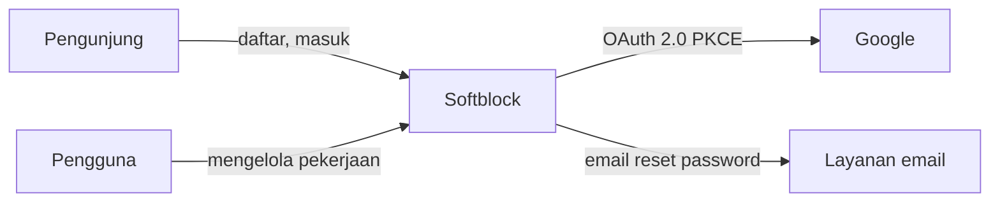
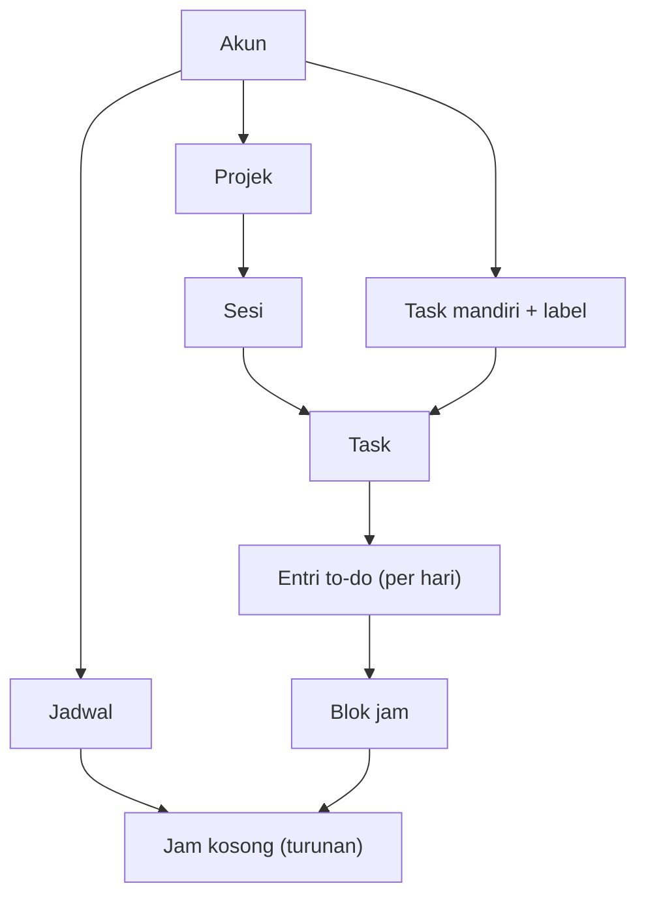
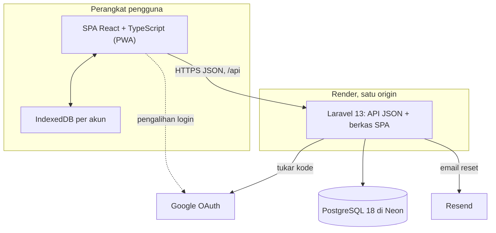

# Deskripsi Sistem: Softblock (Perencana Kerja Pribadi)

Nov 15, 2026 · @cah

> Dokumen ini menjelaskan sistem secara utuh dalam satu tempat: apa yang dilakukan sistem, siapa yang memakainya, bagaimana sistem tersusun, dan apa batasnya. Isinya merangkum empat dokumen pendamping di Projek ini, yaitu Spesifikasi Kebutuhan (FR dan NFR), Dokumen Use Case, Arsitektur Informasi, dan Arsitektur Sistem. Rujukan seperti A-04, N-47, UC-21, AD-3, dan DP-1 menunjuk butir di dokumen-dokumen itu. Bila ada perbedaan, dokumen sumber yang berlaku.

## 1. Gambaran umum

Softblock adalah aplikasi web perencana kerja pribadi. Pekerjaan diatur dalam struktur **Projek → Sesi → Task**, lalu dijadwalkan sebagai to-do harian berblok jam di antara kegiatan tetap (Jadwal). Kalender dan Dashboard dipakai untuk melihat beban kerja dan pola kerja.

| Aspek | Keterangan |
| --- | --- |
| Jenis sistem | Aplikasi web responsif (laptop dan HP), bisa dipasang ke layar utama (PWA). Tanpa aplikasi native |
| Pengguna | Siapa saja yang mendaftar. Tiap akun dipakai satu orang dan datanya terpisah penuh dari akun lain (U-01) |
| Bahasa | Hanya bahasa Indonesia (N-55) |
| Mode kerja | Daring untuk mengubah data. Luring hanya untuk membaca data terakhir yang dimuat (N-47) |
| Tahap sekarang | Desain produk selesai (kebutuhan, use case, arsitektur informasi, wireframe, arsitektur sistem). Implementasi belum dimulai |

### 1.1 Apa yang bisa dilakukan pengguna

- Menyusun pekerjaan sebagai projek berisi sesi (rentang tanggal) dan task, atau membuat task mandiri yang berdiri sendiri dengan label sendiri.
- Mencatat kemajuan task dengan progress 0 sampai 10 beserta riwayatnya. Progress 10 berarti task selesai.
- Memilih task untuk dikerjakan pada hari tertentu (to-do harian), lalu memberinya blok jam.
- Mencatat kegiatan tetap (kuliah, rapat, rutinitas) sebagai Jadwal mingguan atau sekali jalan, dan melihat jam kosong yang tersisa.
- Meninjau semuanya lewat Kalender (bulan dan minggu) dan Dashboard (task telat, tujuh hari ke depan, kondisi projek, pola kerja).

### 1.2 Prinsip desain

- **Server adalah sumber kebenaran tunggal.** Perangkat hanya menyimpan salinan baca-saja untuk offline, sehingga tidak ada penyelesaian konflik dua arah (AD-2).
- **Status dihitung, bukan disimpan.** Status projek, sesi, telat, dan jam kosong dihitung saat dibaca. Yang disimpan hanya "batal" dan progress (N-04, AD-5).
- **Aksi berdampak selalu dikonfirmasi dan diperiksa ulang server.** Tiga tingkat konfirmasi: berat, ringan, dan tanpa konfirmasi (I-03).
- **Riwayat tidak diubah.** Riwayat progress bersifat append-only, hari lewat membeku, dan Jadwal berversi (N-03).
- **Tanpa skor, streak, atau peringkat.** Pola kerja hanya menampilkan data apa adanya (D-11).

## 2. Pengguna dan pihak terkait

| Pihak | Peran | Interaksi dengan sistem |
| --- | --- | --- |
| Pengunjung | Belum masuk | Mendaftar, masuk, meminta reset password (UC-01 sampai UC-04) |
| Pengguna | Sudah masuk | Mengelola projek, sesi, task, to-do, Jadwal, Kalender, Dashboard, dan Akun (UC-05 sampai UC-39) |
| Google | Sistem eksternal | Penyedia identitas login (OAuth 2.0 dengan PKCE) |
| Layanan email | Sistem eksternal | Mengirim email reset password saja |

Tidak ada peran admin di dalam aplikasi (N-23). Pemulihan akun dan backup adalah prosedur operasional di luar aplikasi (N-63, N-74).



## 3. Ruang lingkup

### 3.1 Termasuk dalam sistem

Akses dan akun, Projek, Sesi, Task dan label, Progress, Daftar Task, To-do harian dan blok jam, Jadwal dan jam kosong, Kalender, Dashboard dan Pola kerja, konfirmasi aksi, mode offline baca-saja, dan pemasangan ke layar utama. Rinciannya ada di 96 FR dan 77 NFR pada Spesifikasi Kebutuhan, serta 39 use case pada Dokumen Use Case.

### 3.2 Di luar cakupan (ditunda atau tidak dibuat)

| Butir | Keterangan |
| --- | --- |
| Ekspor dan pemulihan data | Ditunda. Bagian "Data dan Pengaturan" di FR ditunda |
| Notifikasi dorong | Tidak ada (N-51) |
| Daftar perangkat dan "keluar dari semua perangkat" | Ditunda (N-59) |
| Ubah email, hapus akun mandiri | Email tidak bisa diubah (U-11). Penghapusan akun lewat skrip admin (8.4 Arsitektur Sistem) |
| Verifikasi email saat daftar, onboarding | Tidak ada (U-02, N-57) |
| Bahasa lain, tombol tema manual | Tidak ada. Tema terang atau gelap mengikuti perangkat (N-55, N-56) |
| Perubahan data saat offline | Tidak ada. Antrean sinkron tidak dibangun (AD-2) |
| Kolaborasi antarpengguna | Tidak ada. Satu akun dipakai satu orang |

## 4. Konsep inti



| Konsep | Penjelasan |
| --- | --- |
| Projek | Wadah pekerjaan. Punya nama, deskripsi, warna, dan maksimal 10 dokumen berupa tautan. Status turunan: belum dijadwalkan, belum mulai, berjalan, jeda, melewati jadwal, selesai. "Batal" disimpan |
| Sesi | Rentang tanggal dalam projek. Sesi non-batal tidak boleh tumpang tindih. Sesi bukan halaman sendiri, melainkan bagian dari Detail Projek |
| Task | Unit pekerjaan dengan deadline, kesulitan 1 sampai 5, dan progress 0 sampai 10. Berada di sesi (berlabel nama projek) atau berdiri sendiri (berlabel sendiri) |
| Projek tertutup | Projek selesai atau batal. Terkunci sampai dibuka kembali (A-07) |
| To-do harian | Satu entri per task per hari. Hari ini bebas diubah, hari lewat membeku |
| Blok jam | Jam kerja sebuah entri, antara 06.00 dan 24.00, kelipatan 5 menit. Satu entri boleh punya beberapa blok |
| Jadwal | Kegiatan tetap. Mingguan atau sekali jalan, berversi, bisa dikecualikan pada rentang tanggal |
| Jam kosong | Turunan: 06.00 sampai 24.00 dikurangi Jadwal aktif dan blok. Slot di bawah 30 menit tidak dihitung |
| "Hari ini" | Ditentukan server menurut zona waktu akun dan tidak pernah mundur (U-14, AD-6) |

## 5. Fungsi sistem

| Area | Fungsi utama | FR | Use case |
| --- | --- | --- | --- |
| Akses dan Akun | Daftar dengan email, masuk dengan email atau Google, reset password, ganti password, nama tampil, zona waktu, keluar, login ulang saat sesi habis | U-01 sampai U-15 | UC-01 sampai UC-07 |
| Projek | Buat, ubah, selesai dini, batal, hapus, buka kembali, kelola dokumen, daftar dan detail | A-01 sampai A-08 | UC-08 sampai UC-14 |
| Sesi | Buat, ubah periode, hapus, batal | B-01 sampai B-06 | UC-15 sampai UC-18 |
| Task dan label | Buat di sesi atau mandiri, ubah, pindah, batal, buka kembali, kelola label | C-01 sampai C-05, C-03, H-07 | UC-19 sampai UC-22, UC-24, UC-25, UC-26 |
| Progress | Ubah progress, selesai, riwayat | C-06 sampai C-09 | UC-23 |
| Daftar Task | Filter, pencarian, aksi cepat, panel detail | H-01 sampai H-08, D-04 | UC-27, UC-39 |
| To-do harian | Tambah ke to-do, panel penyusunan, blok jam, ceklis, daftar "Belum selesai" | E-01 sampai E-12 | UC-28 sampai UC-31 |
| Jadwal | Buat, ubah, akhiri, pengecualian, peringatan bentrok, jam kosong | F-01 sampai F-09 | UC-32 sampai UC-35 |
| Kalender | Tampilan bulan dan minggu, panel hari, hari lewat baca-saja | G-01 sampai G-05 | UC-36 |
| Dashboard | Task telat, hari ini + 7 hari, ringkasan to-do, jam kosong, projek, kalender mini, pola kerja | D-01 sampai D-12 | UC-37, UC-38 |
| Konfirmasi | Dialog berat, dialog ringan, pembaruan instan, dialog kondisional | I-03 sampai I-10 | AU-4 |
| Navigasi | Lima item utama, tab Kalender, aturan overlay, alamat panel | J-01 sampai J-07 | n/a |

### 5.1 Perilaku lintas fitur

Perilaku ini berlaku di semua fungsi (AU-1 sampai AU-7 di Dokumen Use Case):

- **Sesi habis:** dialog login ulang di atas formulir, isian tidak hilang.
- **Offline:** halaman terbaca dari salinan lokal dengan penanda "Data per [waktu]", semua tombol ubah dinonaktifkan beserta alasannya.
- **Data berubah di perangkat lain:** penyimpanan ditolak dengan pesan "Data berubah di perangkat lain. Muat ulang?"
- **Versi aplikasi usang:** bilah "Ada versi baru aplikasi" dengan tombol Muat ulang.
- **Server lambat bangun:** setelah 8 detik muncul keterangan, dan klien menyerah ke galat setelah 90 detik.

## 6. Struktur halaman dan navigasi

Aplikasi punya 11 halaman: 4 di zona publik dan 7 di zona terautentikasi, dengan kedalaman maksimal dua tingkat.

```
ZONA PUBLIK: Masuk · Daftar · Lupa password · Reset password
ZONA TERAUTENTIKASI:
  Dashboard (halaman awal)
  Projek → Daftar Projek, Detail Projek
  Daftar Task
  To-do
  Kalender → tab Bulan, Minggu, Jadwal (sub-tab Aktif, Berakhir, Pengecualian)
  Akun (lewat ikon profil)
```

- Navigasi utama berisi lima tujuan: Dashboard, Projek, Task, To-do, Kalender. Sidebar kiri di laptop, bilah bawah di HP.
- Detail task, panel hari, dan panel penyusunan berupa panel, bukan halaman. Overlay bertumpuk maksimal tiga lapis: panel, formulir, dialog konfirmasi (J-06).
- Tata letak Dashboard dan Detail Projek ditetapkan di Arsitektur Informasi Bagian 6.4.

## 7. Arsitektur sistem

### 7.1 Gambaran



### 7.2 Teknologi

| Lapisan | Pilihan |
| --- | --- |
| Frontend | React, TypeScript mode ketat, Vite, Tailwind. SPA dan PWA. Salinan offline di IndexedDB |
| Backend | PHP 8.4 atau 8.5, Laravel 13. API JSON saja, menyajikan SPA dari origin yang sama |
| Database | PostgreSQL 18 (satu instans, ekstensi `btree_gist`) |
| Autentikasi | Laravel Sanctum mode SPA (cookie sesi + CSRF), Argon2id, Laravel Socialite untuk Google |
| Email | Laravel Mail dengan Resend, hanya untuk reset password |
| Kontrak API | Scramble (OpenAPI 3.1) → `openapi-typescript` → `openapi-fetch` |
| Pengujian | Pest atau PHPUnit (PostgreSQL asli), PHPStan atau Larastan, Vitest, Playwright |
| Repositori dan CI/CD | Monorepo pnpm (`apps/web`, `apps/api`, folder fixture bersama), GitHub Actions |

### 7.3 Keputusan arsitektur utama

| ID | Keputusan |
| --- | --- |
| AD-1 | Modular monolith: satu aplikasi Laravel dengan enam modul (Akun, Projek, Task, To-do, Jadwal, Ringkasan) |
| AD-2 | Server sumber kebenaran tunggal. Perangkat baca-saja saat offline |
| AD-3 | Satu aksi = satu transaksi. Kunci per akun diambil dengan menaikkan nomor revisi pada baris akun |
| AD-4 | Pola "dampak yang diharapkan": klien menghitung dampak, server menghitung ulang di bawah kunci, dan menolak dengan 409 bila berbeda |
| AD-5 | Status turunan tidak disimpan |
| AD-6 | "Hari ini" ditentukan server menurut zona waktu akun, tidak pernah mundur |
| AD-7 | Satu origin untuk SPA dan API, sehingga tanpa CORS |
| AD-8 | Aturan domain berupa fungsi murni, ditulis di PHP dan TypeScript, diikat golden fixtures bersama |

### 7.4 Sinkronisasi dan offline

Pembacaan hanya lewat dua endpoint: `GET /api/sinkron?sejak=<revisi>` (data penuh atau delta) dan `GET /api/pola-kerja`. Setiap transaksi pengubah menaikkan nomor revisi akun, dan nomor itu dipakai sebagai kunci, versi record, dan kursor sinkron. Kalender, Dashboard, filter, dan jam kosong dihitung di perangkat dari salinan lokal. Pembaruan instan berlaku untuk ceklis, progress, tambah ke to-do, dan hapus entri (N-50). Aksi bertingkat konfirmasi selalu menunggu server.

## 8. Data

- Satu database PostgreSQL. Setiap tabel data punya `akun_id`, dan foreign key anak bersifat komposit `(akun_id, id)` (DA-2).
- Tanggal bertipe `date`, jam disimpan sebagai menit 0 sampai 1440, dan cap waktu UTC hanya untuk metadata (DA-3).
- Entitas utama: `akun`, `projek`, `dokumen`, `sesi`, `label_mandiri`, `task`, `riwayat_progress`, `entri_todo`, `blok_jam`, `jadwal`, `jadwal_versi`, `pengecualian`, dan `penghapusan` (untuk sinkron delta).
- Aturan yang bisa dinyatakan sebagai constraint dijaga database: email unik, nama unik, rentang sesi tanpa tumpang tindih, satu entri per task per hari, blok tanpa tumpang tindih. Aturan lintas tabel (misalnya warna projek unik) dijaga aplikasi di bawah kunci akun (N-75).
- Riwayat progress append-only: pemicu menolak ubah dan hapus (DA-6).
- Perkiraan volume: sekitar 25 MB database per akun pada volume lima tahun (N-08). Neon gratis menampung sekitar 40 akun bervolume penuh.

## 9. Keamanan dan privasi

| Aspek | Ringkasan |
| --- | --- |
| Transport | HTTPS dengan HSTS (N-22). Koneksi database TLS verify-full (N-32) |
| Autentikasi | Cookie sesi `__Host-…` httpOnly, Secure, SameSite=Lax. Sesi 30 hari, diperpanjang saat dipakai. Argon2id (S-1, S-2) |
| Login Google | OAuth 2.0 authorization code dengan PKCE dan state, hanya email terverifikasi, cakupan `openid email profile` (N-72) |
| Pembatasan percobaan | Lima kali gagal menunda login 15 menit, dihitung per akun dan per IP. Registrasi dibatasi per IP (N-25, N-77) |
| Isolasi antar-akun | Tiga lapis: foreign key komposit, scope model dan route binding, pengujian otomatis. Data akun lain dijawab "tidak ditemukan" (S-3, N-61) |
| Header | CSP ketat, `frame-ancestors 'none'`, `Cache-Control: no-store` pada `/api`, tanpa CORS (S-4) |
| Privasi | Tanpa pelacak, analitik, atau skrip pihak ketiga. Log JSON tanpa email, nama, atau isi task (N-30, S-6) |
| Rantai pasok | Lockfile, audit dependensi di CI, aksi GitHub dikunci ke SHA, `gitleaks` (S-7) |

Risiko sisa yang diterima untuk fase lomba dicatat di Arsitektur Sistem 8.4, antara lain data yang ditanam sebelum pemilik email mendaftar (email tidak diverifikasi), enumerasi email lewat pesan "sudah terdaftar", dan salinan offline yang tidak dienkripsi.

## 10. Deployment dan operasi

| Aspek | Ringkasan |
| --- | --- |
| Hosting (fase gratis) | Render (Docker) + Neon (PostgreSQL 18) + Resend + GitHub Actions (DP-1) |
| Image | Satu image Docker multi-stage (nginx + php-fpm + SPA), dibangun sekali di CI dan ditarik Render dari GHCR (DP-2) |
| Pipeline | CI pada setiap perubahan. Deploy hanya dari `main` dengan persetujuan manual: backup pra-migrasi, migrasi, rilis, smoke test (DP-5) |
| Backup | Harian, retensi 7 hari, dienkripsi, kehilangan data maksimal 24 jam, target pulih 4 jam (DP-6, N-74) |
| Perawatan | Pembersihan mingguan atas cache, sesi, token reset, dan tombstone (DP-7) |
| Kesehatan | `GET /api/kesehatan` (tanpa database, untuk membangunkan server) dan `/api/kesehatan/siap` (dengan database). Tanpa ping terus-menerus (DP-8) |
| Pemantauan | Manual mingguan oleh PM: storage dan CU-jam Neon, jam instance Render, kuota email, kesehatan backup (DP-10) |
| Jalur naik | Render berbayar dan Neon Launch tanpa migrasi data. Ambang: storage di atas 70%, CU-jam di atas 80 dari 100, email di atas 70 per hari, atau cold start mengganggu demo |

## 11. Target mutu

| Aspek | Target | Rujukan |
| --- | --- | --- |
| Kecepatan | Dashboard (di luar Pola kerja) bisa dipakai dalam 2 detik. Pindah halaman dan buka Kalender bulan dalam 1 detik. Pola kerja tampil dalam 3 detik untuk rentang "Semua" | N-09, N-70 |
| Volume | Lima tahun pemakaian harian per akun: 100 projek, 600 sesi, 10.000 task, 30.000 entri to-do, 100.000 baris riwayat | N-08 |
| Platform | Laptop minimal 1280 px, HP minimal 360 px. Dua versi terakhir Chrome, Edge, Firefox, Safari | N-07 |
| Aksesibilitas | WCAG 2.2 AA untuk alur inti, kontras 4,5:1, target sentuh 44 pt, bisa dioperasikan dengan keyboard, warna bukan satu-satunya pembawa makna | N-14 sampai N-19, N-52 |
| Pengujian | Aturan domain, aksi berantai, pemeriksaan versi, isolasi antar-akun, dan alur autentikasi wajib diuji otomatis | N-39, N-66 |

## 12. Asumsi, batasan, dan hal terbuka

**Batasan fase gratis.** Server Render tidur setelah 15 menit tanpa trafik dan butuh sampai sekitar satu menit untuk bangun. Kapasitas N-69 (1.000 akun terdaftar, 100 akun aktif bersamaan) tidak dijamin di fase gratis dan perlu uji beban sebelum dijanjikan.

**Hal terbuka dari Arsitektur Sistem (Bagian 12):**

- Katalog endpoint per modul belum ditulis. Dihasilkan dari OpenAPI saat implementasi.
- Delapan hal harus diuji di hari pertama implementasi (Arsitektur Sistem 9.4), antara lain sumber IP klien di balik proxy Render, role SQL kustom di Neon, kuota storage Neon, dan status layar persetujuan Google OAuth.
- Versi Node LTS dan versi PHP yang di-pin ditetapkan saat implementasi.
- Pastikan minimal dua anggota tim punya akses ke GitHub, Render, Neon, Resend, dan Google, dengan autentikasi dua langkah.
- Peninjauan privasi terhadap UU Pelindungan Data Pribadi (UU 27/2022) diperlukan sebelum rilis publik. Ini bukan nasihat hukum.

**Fakta hosting cepat berubah.** Angka batas Render, Neon, dan Resend diperiksa 15 Nov 2026 dan perlu dicek ulang sebelum keputusan berbayar.

## 13. Dokumen terkait

| Dokumen | Isi | Berkas di Projek |
| --- | --- | --- |
| Spesifikasi Kebutuhan (FR dan NFR) | 96 FR dan 77 NFR, istilah baku, aturan lintas fitur | `claude/spesifikasi-kebutuhan-fr-nfr.md` |
| Dokumen Use Case | 39 use case, 7 alur umum (AU-1 sampai AU-7) | `claude/dokumen-use-case.md` |
| Arsitektur Informasi | 70 fitur, 15 jenis konten, 11 halaman, navigasi, relasi konten | `claude/dokumen-arsitektur-informasi.md` |
| Arsitektur Sistem | Konteks, komponen, data, antarmuka, keamanan, deployment | `claude/dokumen-arsitektur-sistem.md` |
